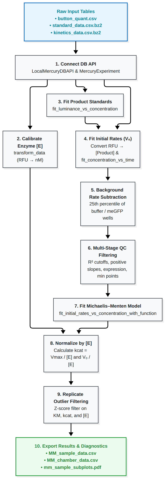

# Michaelis-Menten Analysis & QC Walkthrough

This guide provides a comprehensive, step-by-step walkthrough of the standard enzyme kinetics analysis pipeline in Mercury, based on the template notebook [`htbam_notebooks/analysis_mm.ipynb`](https://github.com/pinneylab/mercury_notebooks/blob/main/htbam_notebooks/analysis_mm.ipynb).

It starts from quantified fluorescence tables and walks all the way through enzyme calibration, product calibration, initial rate fitting, background rate subtraction, quality-control filtering, Michaelis–Menten model fitting, replicate aggregation, and publication-ready diagnostic exports.

---

## Overview of the Analysis Pipeline

{: .half-size width="50%" }

---

## 1. Setup & Database Connection

Before starting your analysis, copy the template notebook so your original template stays clean:

```bash
cp htbam_notebooks/analysis_mm.ipynb my_experiment_analysis.ipynb
```

In your notebook or script, load the required modules and connect to your quantified data tables via `LocalMercuryDBAPI`:

```python
from pathlib import Path
from mercury.db_api.mercury_db_api import LocalMercuryDBAPI
from mercury.analysis.experiment import MercuryExperiment
from mercury.analysis import plot
from mercury.db_api.units import units

# Calibration constant for eGFP fluorescence (RFU to nM)
EGFP_SLOPE = (91900.03 / 9) * (units.RFU / units.nM)

# Path to the directory containing your quantified CSV/bz2 tables
root = Path('./your_data_folder/')

db_conn = LocalMercuryDBAPI(
    # Product standard curve measurements
    standard_curve_data_path=str(root / 'standard_data.csv.bz2'),
    standard_name="NADPH", 
    standard_substrate="NADPH", 
    standard_units=units.uM,
    standard_concentration_col="concentration",  # Must match the column in standard CSV
    
    # Kinetic reaction progress measurements
    kinetic_data_path=str(root / 'kinetics_data.csv.bz2'),
    kinetic_name="ADP", 
    kinetic_substrate="ADP", 
    kinetic_units=units.uM,
    kinetic_concentration_col="adp_conc",        # Must match substrate column in kinetics CSV
    
    # Timing and protein expression measurements
    time_units=units.s,
    button_quant_data_path=str(root / 'button_quant.csv')
)

mercury_experiment = MercuryExperiment(db_conn)
print("Loaded runs:", db_conn.get_run_names())
# Expected: ['NADPH', 'ADP', 'button_quant']
```

---

## 2. Enzyme Quantification

Convert surface-bound fluorescence intensity under the button ROI into molar enzyme concentration [E]:

```python
from mercury.analysis.transform import transform_data

button_concentrations = transform_data(
    data_objs=[mercury_experiment.get_run('button_quant')],
    expr='(a_luminance / slope)',
    expression_vars={'slope': EGFP_SLOPE},
    output_name='concentration'
)

mercury_experiment.set_run('enzyme_concentrations', button_concentrations)

# Interactively inspect enzyme expression across the chip:
plot.plot_enzyme_concentration_chip(mercury_experiment, analysis_name='enzyme_concentrations')
```

---

## 3. Product Standard Curve Calibration

Fit calibration curves for each chamber to convert fluorescence units (RFU) into micromolar product concentration:

```python
from mercury.analysis.fit import fit_luminance_vs_concentration

standard_experiment_data = mercury_experiment.get_run('NADPH')
standard_fits = fit_luminance_vs_concentration(standard_experiment_data)
mercury_experiment.set_run('NADPH_standard', standard_fits)

# Inspect standard curve fits across chambers
plot.plot_standard_curve_chip(mercury_experiment, 'NADPH_standard', 'NADPH')
```

> **Tip - Masking bad standard points:**
> If a particular standard concentration had a pipetting or imaging glitch, you can mask it using `mercury.analysis.filter.make_custom_mask` before calling `fit_luminance_vs_concentration`.

---

## 4. Initial Velocity (V<sub>0</sub>) Fitting

Using the fitted calibration lines, convert time-course kinetics fluorescence into product concentrations, then fit the linear initial velocity slope V<sub>0</sub>:

```python
from mercury.analysis.fit import fit_concentration_vs_time

# 1. Convert RFU to product concentration per chamber: [P] = (RFU - intercept) / slope
product_concentrations = transform_data(
    data_objs=[mercury_experiment.get_run('ADP'), mercury_experiment.get_run('NADPH_standard')],
    expr='(a.luminance - b.intercept) / b.slope',
    output_name='concentration'
)
mercury_experiment.set_run('kinetics_ADP_conc', product_concentrations)

# 2. Fit linear initial rates
kinetics_concentrations = mercury_experiment.get_run('kinetics_ADP_conc')
kinetics_fits, fit_points_mask = fit_concentration_vs_time(
    kinetics_concentrations, 
    start_timepoint=1,            # Skip initial mixing/settling artifacts
    end_timepoint=10,             # Upper bound of initial linear region
    max_reaction_percent=10       # Keep points with <= 10% substrate consumed
)

mercury_experiment.set_run('kinetics_ADP_conc_fits', kinetics_fits)
mercury_experiment.set_run('fit_points_mask', fit_points_mask)

# Inspect initial rates on the chip
plot.plot_initial_rates_chip(
    mercury_experiment, 
    analysis_name='kinetics_ADP_conc_fits', 
    experiment_name='kinetics_ADP_conc',
    fit_points_mask='fit_points_mask'
)
```

---

## 5. Non-Enzymatic Background Rate Subtraction

In many assays, substrate degrades spontaneously or undergoes non-enzymatic reaction. We estimate this background rate from negative-control chambers (e.g. `meGFP` or buffer wells) and subtract it from all active chambers:

```python
from mercury.analysis.filter import filter_by_sample_id

# 1. Isolate control/buffer chambers
buffer_mask = filter_by_sample_id(kinetics_fits, sample_ids=['meGFP'])
mercury_experiment.set_run('buffer_mask', buffer_mask)

mercury_experiment.apply_mask(
    run_name='kinetics_ADP_conc_fits', 
    dep_variables=['slope', 'intercept', 'r_squared'], 
    save_as='buffer_wells',
    mask_names=['buffer_mask']
)

# 2. Compute the 25th percentile of control slopes (robust against outliers)
buffer_wells = mercury_experiment.get_run('buffer_wells')
buffer_wells_lower_quartile = transform_data(
    data_objs=[buffer_wells],
    expr='np.nanpercentile(a.device.slope, 25, axis=1)',
    output_name='slope_lower_quartile'
)
mercury_experiment.set_run('buffer_wells_lower_quartile', buffer_wells_lower_quartile)

# 3. Subtract background rate from every chamber
corrected_initial_rates = transform_data(
    data_objs=[
        mercury_experiment.get_run('kinetics_ADP_conc_fits'), 
        mercury_experiment.get_run('buffer_wells_lower_quartile')
    ],
    expr='(a.chamber.slope - b.chamber.slope_lower_quartile)',
    output_name='slope',
    keep_existing=True
)
mercury_experiment.set_run('kinetics_ADP_conc_fits_bgsub', corrected_initial_rates)
```

---

## 6. Multi-Stage Quality-Control Filtering

Ensure low-quality or aberrant chambers do not corrupt kinetic fits:

```python
from mercury.analysis.filter import (
    filter_initial_rates_r2_cutoff,
    filter_initial_rates_positive_cutoff,
    filter_standard_curve_r2_cutoff,
    filter_expression_cutoff,
    filter_number_concentrations,
)

kinetics_fits_bgsub = mercury_experiment.get_run('kinetics_ADP_conc_fits_bgsub')

# Build individual filter masks:
initial_rates_r2_mask = filter_initial_rates_r2_cutoff(kinetics_fits_bgsub, r2_cutoff=0.9)
initial_rates_positive_mask = filter_initial_rates_positive_cutoff(kinetics_fits_bgsub)
standard_curve_r2_mask = filter_standard_curve_r2_cutoff(standard_fits, kinetics_fits_bgsub, r2_cutoff=0.9)
expression_mask = filter_expression_cutoff(button_concentrations, kinetics_fits_bgsub, expression_cutoff=1)

mercury_experiment.set_run('initial_rates_r2_mask', initial_rates_r2_mask)
mercury_experiment.set_run('initial_rates_positive_mask', initial_rates_positive_mask)
mercury_experiment.set_run('standard_curve_r2_mask', standard_curve_r2_mask)
mercury_experiment.set_run('expression_mask', expression_mask)

# Preview any mask before applying:
plot.plot_mask_chip(mercury_experiment, mask_name='initial_rates_r2_mask')

# Apply rate-level filters
mercury_experiment.apply_mask(
    run_name='kinetics_ADP_conc_fits_bgsub', 
    dep_variables=['slope', 'intercept'], 
    save_as='kinetics_ADP_conc_fits_masked',
    mask_names=['initial_rates_r2_mask', 'initial_rates_positive_mask', 'standard_curve_r2_mask', 'expression_mask']
)

# Enforce minimum concentration requirement (e.g. at least 5 valid concentrations):
kinetics_fits_masked = mercury_experiment.get_run('kinetics_ADP_conc_fits_masked')
number_initial_rates_mask = filter_number_concentrations(kinetics_fits_masked, min_concentrations=5, var_to_check='slope')
mercury_experiment.set_run('number_initial_rates_mask', number_initial_rates_mask)

mercury_experiment.apply_mask(
    run_name='kinetics_ADP_conc_fits_masked', 
    dep_variables=['slope', 'intercept', 'r_squared'], 
    save_as='kinetics_ADP_conc_fits_masked',
    mask_names=['number_initial_rates_mask']
)
```

---

## 7. Michaelis–Menten Model Fitting

Fit initial rates across substrate concentrations to the Michaelis–Menten equation:

<p align="center">
  <i>V</i><sub>0</sub> = (<i>V</i><sub>max</sub> &middot; [S]) / (<i>K</i><sub>M</sub> + [S])
</p>

```python
from mercury.analysis.fit import fit_initial_rates_vs_concentration_with_function, mm_model
from mercury.analysis.filter import filter_r2_cutoff, filter_number_replicates

kinetics_fits_masked = mercury_experiment.get_run('kinetics_ADP_conc_fits_masked')
MM_fits, MM_pred_data = fit_initial_rates_vs_concentration_with_function(
    data=kinetics_fits_masked,
    model_func=mm_model
)

mercury_experiment.set_run('kinetics_ADP_MM_fits', MM_fits)
mercury_experiment.set_run('kinetics_ADP_MM_pred_data', MM_pred_data)

# Filter fits by goodness-of-fit (R^2 >= 0.8) and minimum replicate count (>= 3):
MM_fits = mercury_experiment.get_run('kinetics_ADP_MM_fits')
MM_fits_mask = filter_r2_cutoff(MM_fits, r2_cutoff=0.8)
MM_fits_replicate_mask = filter_number_replicates(MM_fits, min_replicates=3, var_to_check='K_m')

mercury_experiment.set_run('MM_R2_mask', MM_fits_mask)
mercury_experiment.set_run('MM_replicate_mask', MM_fits_replicate_mask)

mercury_experiment.apply_mask(
    run_name='kinetics_ADP_MM_fits', 
    dep_variables=['v_max', 'K_m', 'r_squared'], 
    save_as='kinetics_ADP_MM_fits_masked',
    mask_names=['MM_R2_mask', 'MM_replicate_mask']
)

# Plot Michaelis-Menten fits on the chip
plot.plot_MM_chip(
    experiment=mercury_experiment, 
    analysis_name='kinetics_ADP_conc_fits_masked', 
    model_fit_name='kinetics_ADP_MM_fits_masked',
    model_pred_data_name='kinetics_ADP_MM_pred_data'
)
```

---

## 8. Normalizing by [E] for k<sub>cat</sub> and V<sub>0</sub> / [E]

Calculate catalytic rate constants (<i>k</i><sub>cat</sub> = <i>V</i><sub>max</sub> / [E]) and normalized velocities:

```python
enzyme_concentrations = mercury_experiment.get_run("enzyme_concentrations")
masked_slopes_vs_conc = mercury_experiment.get_run("kinetics_ADP_conc_fits_masked")
masked_fits = mercury_experiment.get_run("kinetics_ADP_MM_fits_masked")
pred_data = mercury_experiment.get_run("kinetics_ADP_MM_pred_data")

# 1. Normalize initial rates: V_0 / [E]
masked_V0_div_E_vs_conc = transform_data(
    data_objs=[masked_slopes_vs_conc, enzyme_concentrations],
    expr='a_slope / b_concentration',
    output_name='V0_div_E'
)

# 2. Normalize Vmax to get kcat: kcat = Vmax / [E]
masked_fits_with_kcat = transform_data(
    data_objs=[masked_fits, enzyme_concentrations],
    expr='a_v_max / b_concentration',
    output_name='kcat',
    keep_existing=True
)

# 3. Normalize predicted model curves:
pred_data_div_E = transform_data(
    data_objs=[pred_data, enzyme_concentrations],
    expr='a_y_pred / b_concentration',
    output_name='pred_V0_div_E'
)

mercury_experiment.set_run('masked_V0_div_E_vs_conc', masked_V0_div_E_vs_conc)
mercury_experiment.set_run('masked_fits_with_kcat', masked_fits_with_kcat)
mercury_experiment.set_run('pred_data_div_E', pred_data_div_E)
```

---

## 9. Replicate Outlier Filtering (Z-Score Filtering)

Biological microfluidic chips contain replicates of each variant across different chambers. We filter out chambers whose <i>K</i><sub>M</sub>, <i>k</i><sub>cat</sub>, or [E] deviates significantly (> 1.5 standard deviations) from the replicate mean:

```python
z_score_threshold = 1.5

# Mask chambers with aberrant KM
MM_outlier_mask_KM = transform_data(
    data_objs=[mercury_experiment.get_run('masked_fits_with_kcat')],
    expr='~(np.abs(a.chamber.K_m - np.nanmean(a.sample.K_m)) > z_score_threshold * np.nanstd(a.sample.K_m))',
    expression_vars={'z_score_threshold': z_score_threshold},
    output_name='mask'
)

# Mask chambers with aberrant kcat
MM_outlier_mask_kcat = transform_data(
    data_objs=[mercury_experiment.get_run('masked_fits_with_kcat')],
    expr='~(np.abs(a.chamber.kcat - np.nanmean(a.sample.kcat)) > z_score_threshold * np.nanstd(a.sample.kcat))',
    expression_vars={'z_score_threshold': z_score_threshold},
    output_name='mask'
)

# Mask chambers with aberrant protein loading
MM_outlier_mask_expression = transform_data(
    data_objs=[mercury_experiment.get_run('enzyme_concentrations')],
    expr='~(np.abs(a.chamber.concentration - np.nanmean(a.sample.concentration)) > z_score_threshold * np.nanstd(a.sample.concentration))',
    expression_vars={'z_score_threshold': z_score_threshold},
    output_name='mask'
)

# Combine masks with logical AND
MM_outlier_mask = transform_data(
    data_objs=[MM_outlier_mask_KM, MM_outlier_mask_kcat, MM_outlier_mask_expression],
    expr='a.mask.magnitude & b.mask.magnitude & c.mask.magnitude',
    output_name='mask'
)
mercury_experiment.set_run('MM_outlier_mask', MM_outlier_mask)

# Apply outlier mask
mercury_experiment.apply_mask(
    run_name='masked_fits_with_kcat',
    dep_variables=['v_max', 'K_m', 'r_squared', 'kcat'], 
    save_as='masked_fits_with_kcat_filtered',
    mask_names=['MM_outlier_mask']
)

mercury_experiment.apply_mask(
    run_name='masked_V0_div_E_vs_conc',
    dep_variables=['V0_div_E'], 
    save_as='masked_V0_div_E_vs_conc_filtered',
    mask_names=['MM_outlier_mask']
)

# Plot final filtered V0/[E] vs concentration:
plot.plot_MM_div_E_chip(
    experiment=mercury_experiment, 
    analysis_name='masked_V0_div_E_vs_conc_filtered', 
    model_fit_name='masked_fits_with_kcat_filtered',
    dep_var_name='V0_div_E',
    model_pred_data_name='pred_data_div_E'
)
```

---

## 10. Exporting Results & Diagnostics

Export summary tables and publication-ready diagnostic plots:

```python
# 1. Export Chamber-Level Results (one row per chamber)
mercury_experiment.export_MM_chamber_data(
    run_name='masked_fits_with_kcat_filtered', 
    enzyme_concentration_run_name='enzyme_concentrations', 
    file_name='MM_chamber_data.csv'
)

# 2. Export Sample-Level Summaries (means, standard deviations, and replicate counts per variant)
mercury_experiment.export_MM_sample_data(
    run_name='masked_fits_with_kcat_filtered', 
    enzyme_concentration_run_name='enzyme_concentrations', 
    file_name='MM_sample_data.csv'
)

# 3. Export Sample Subplots PDF
# Generates a multipage PDF showing Michaelis-Menten curves, replicate error bars, and parameter envelopes
mercury_experiment.export_mm_subplots_by_sample(
    analysis_name='masked_V0_div_E_vs_conc_filtered',
    model_fit_name='masked_fits_with_kcat_filtered',
    dep_var_label='V0_div_E',
    export_path='mm_sample_subplots.pdf'
)

# 4. (Optional) Full End-to-End Visual Summary
# Generates comprehensive diagnostics for each sample showing raw images, standard curves, initial rates, and fits
# mercury_experiment.export_end_to_end_summary_by_sample(
#     export_dir='./all_samples_visual_summary',
#     button_quant_csv=str(root / 'button_quant.csv'),
#     standard_curve_csv=str(root / 'standard_data.csv.bz2'),
#     kinetics_csv=str(root / 'kinetics_data.csv.bz2')
# )
```

---

## Output Files Summary

| File | Level | Description |
|---|---|---|
| `MM_sample_data.csv` | Sample | Aggregated <i>k</i><sub>cat</sub>, <i>K</i><sub>M</sub>, [E], fit R<sup>2</sup>, and replicate count per variant |
| `MM_chamber_data.csv` | Chamber | Individual chamber fit parameters, standard errors, and outlier status |
| `mm_sample_subplots.pdf` | Visual | Subplot grid showing mean rates, standard error bars, and Michaelis–Menten fit curves |
| `all_samples_visual_summary/` | Diagnostic | Multi-panel visual summaries showing microscope stamp images, standard curves, and rate slopes |
