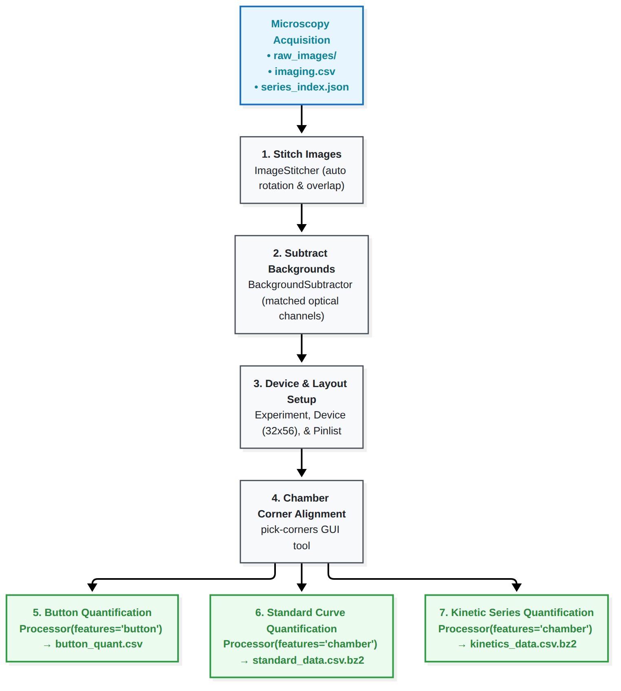

# Image Processing & Quantification Walkthrough

This guide provides a comprehensive walkthrough for converting raw, tiled microscopy images from high-throughput microfluidic experiments (HT-BAM / HT-MEK) into the calibrated fluorescence tables used for downstream kinetic analysis, based on [`htbam_notebooks/process.ipynb`](https://github.com/pinneylab/mercury_notebooks/blob/main/htbam_notebooks/process.ipynb).

---

## Overview of the Image Processing Pipeline



---

## 1. Directory Structure & Required Metadata

The processing workflow expects an acquisition folder organized according to the standard automated microscopy protocol:

```text
experiment_root/
├── imaging.csv               # Master acquisition metadata (rasters, exposures, channels)
├── raw_images/               # Subfolders for each acquisition raster
│   ├── 2026-05-10_00-13-33_kinetic_series_MM_Kinetics/
│   │   ├── series_index.json # Series coordinate index and timing
│   │   └── tile_001.tif, tile_002.tif, ...
│   └── ...
└── pinlists/                 # (Optional) Device chamber-to-sample mapping files
    └── device_pinlist.csv
```

---

## 2. Image Stitching (`ImageStitcher`)

Raw microscope images are acquired as overlapping 2D tiles. `ImageStitcher` orchestrates raster stitching, automatic rotation correction, and overlap alignment:

```python
from pathlib import Path
from mercury.stitching import ImageStitcher

root = Path('/path/to/experiment_root')
stitcher = ImageStitcher(root)
```

### (Optional) Testing Rotation Angles
Microscope camera orientation may be slightly offset from the chip axis. You can evaluate candidate rotation angles on a reference image:

```python
stitcher.test_stitching_rotations(
    raster_path=root / 'raw_images/2026-05-09_16-58-08_pre_button_quant_brightfield',
    rotations=[1.0, 1.2, 1.4, 1.6, 1.8, 2.0],
    acqui_origin=(True, False),
    outdir=root / 'stitch_test'
)
```

### Running Stitching
Stitch the entire experiment dataset:

```python
stitcher.stitch_images(
    rotation=None,                       # None enables automatic rotation optimization
    get_rotation_from='*brightfield*',   # Brightfield channels provide the best features for rotation
    acqui_origin=(True, False)           # Microscope stage origin orientation
)
```

Stitched full-device images are written to `root / 'stitched_images'`.

---

## 3. Background Subtraction (`BackgroundSubtractor`)

Autofluorescence, illumination gradients, and optical noise must be subtracted by pairing assay images with channel-matched dark images:

```python
from mercury.stitching import BackgroundSubtractor

# Specify paths to reference background images for each channel:
background_images = [
    root / 'stitched_images/cyan_button_quant_background.tif',
    root / 'stitched_images/green_mscarlet_background.tif',
    root / 'stitched_images/UV340_nadh_background.tif',
]

subtractor = BackgroundSubtractor(root)
subtractor.background_subtract_images(
    background_images=background_images,
    grouping_keys=['channel', 'exposure']  # Match raw images to backgrounds by optical configuration
)
```

Corrected images are written to `root / 'bg_subtracted_images'`.

---

## 4. Initializing Experiment & Device Geometry

Register physical microfluidic devices and pinlist metadata:

```python
from mercury.processing.experiment import Experiment, Device, DataHandler

experiment = Experiment(root)

# Define chip grid geometry (e.g. 32 rows x 56 columns = 1,792 chambers)
d1 = Device(
    setup='s1', 
    dname='d3',                # Must match device name recorded during acquisition
    dims=(32, 56), 
    pinlist_path='pinlists/chip_pinlist.csv'
)

experiment.register_device(d1)
data_handler = DataHandler(experiment)

# Print discovered image series identifiers
data_handler.list_identifiers()
```

---

## 5. Chamber Alignment & Corner Picking (`pick-corners`)

To locate reaction chambers on the stitched overview images, physical chip corners are defined using the interactive GUI utility:

```bash
pick-corners --image stitched_images/reference_brightfield.tif --output corners.json
```

In the interactive window:
1. Zoom in and click the center of the **top-left**, **top-right**, **bottom-left**, and **bottom-right** microfluidic fiducial chambers.
2. The coordinate transformation maps the rectangular chip model onto physical image pixels.

---

## 6. Feature Extraction & Quantification

With corners defined, use `Processor` to extract intensities for protein loading, standard curves, and kinetic series.

### A. Button Quantification (Protein Expression)
Extract fluorescence at antibody/bait spots under the button valves:

```python
from mercury.processing import Processor

button_images = data_handler.get_images(identifiers=['button_quant_run_id'])

# Measure button ROIs
button_processor = Processor(experiment, image_data=button_images, features='button')
button_processor.set_corners(corners_file='corners.json')

button_df = button_processor.process(use_reference=False)
button_df.to_csv(root / 'button_quant.csv', index=False)
```

### B. Product Standard Curves
Extract fluorescence across calibrated product concentrations:

```python
standard_images = data_handler.get_images(identifiers='standard_curve_run_id')

standard_processor = Processor(experiment, image_data=standard_images, features='chamber')
standard_processor.set_corners(corners_file='corners.json')

standard_df = standard_processor.process(use_reference=False)
standard_df.to_csv(root / 'standard_data.csv.bz2', compression='bz2')
```

### C. Kinetic Reaction Series
Extract reaction progress time-series across substrate concentrations:

```python
import pandas as pd

kinetics_images = data_handler.get_images(identifiers='kinetics_series_run_id')

kinetics_processor = Processor(experiment, image_data=kinetics_images, features='chamber')
kinetics_processor.set_corners(corners_file='corners.json')

kinetics_df = kinetics_processor.process(use_reference=False)

# If multiple kinetic sets were collected, concatenate them:
# kinetics_merged = pd.concat([kinetics_df_1, kinetics_df_2], ignore_index=True)

kinetics_df.to_csv(root / 'kinetics_data.csv.bz2', compression='bz2')
```

---

## Transition to Downstream Analysis

Once `button_quant.csv`, `standard_data.csv.bz2`, and `kinetics_data.csv.bz2` are generated in your experiment directory, proceed to the [Michaelis–Menten Analysis Guide](notebook_analysis.md) to fit reaction velocities, apply quality filters, and derive catalytic constants.
